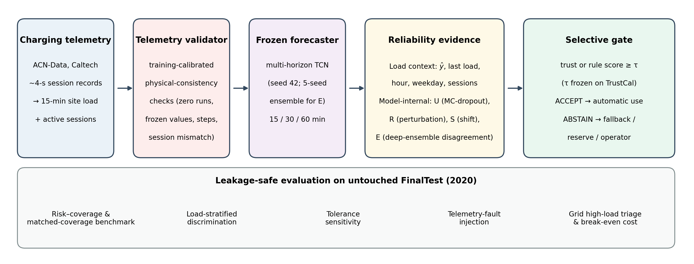

# VeriCharge

**What Makes an EV Charging-Load Forecast Trustworthy? Load Context, Model-Internal Reliability Signals, and Telemetry Faults in Selective Forecasting for Grid-Integrated Charging**

Code, frozen artifacts and a reproducible demo for the paper by **Bashar ALHAJAHMAD** (Siirt University).
Paper: *link to be added after publication*

[](https://colab.research.google.com/github/Dr-Bashar-Uni-Hub/VeriCharge/blob/main/notebooks/03_demo_reproduce_results.ipynb)

---

## Overview

Selective forecasting withholds low-trust forecasts from automatic use. Using 2.6 years of Caltech ACN charging telemetry and a leakage-safe chronological protocol, this repository evaluates what actually identifies an unreliable 15/30/60-min EV charging-load forecast:

- a learned uncertainty–robustness–shift (URS) trust model reduces accepted-forecast MAE by 19–22%, **but a no-fitting predicted-load rule discriminates acceptable forecasts better** (AUROC 0.80–0.81 vs 0.67–0.70);
- deep-ensemble disagreement is a much stronger reliability signal than MC-dropout uncertainty;
- under injected telemetry faults, learned trust accepts almost all dropout-corrupted forecasts;
- a simple training-calibrated telemetry validator removes most harmful automatic acceptances.



## Repository structure

```
VeriCharge/
├── notebooks/
│   ├── 01_VeriCharge_pipeline.ipynb        # original end-to-end pipeline (Colab, GPU): data → TCN → URS trust → frozen policy
│   ├── 02_revision_colab_steps.ipynb       # artifact bundle, deep-ensemble (B1) and fault-injection (B2) inference
│   └── 03_demo_reproduce_results.ipynb     # quick demo: reproduces the main tables/figures from frozen artifacts (CPU)
├── analysis/                               # scripts for the benchmark, ensemble, tolerance, fault and validator analyses
├── results/                                # result tables (CSV) produced by analysis/
├── figures/                                # figures used in the paper
├── data/README.md                          # how to obtain the data and the frozen artifacts
├── requirements.txt
├── CITATION.cff
└── LICENSE
```

## Quick start (demo, ~5 min, CPU)

Open the Colab badge above and run all cells. The notebook clones this repository, downloads the frozen artifacts from the [latest release](../../releases), and reproduces Table 3, Table 4, the fault/validator results and Figures 4–7.

Local alternative:

```bash
git clone https://github.com/Dr-Bashar-Uni-Hub/VeriCharge.git
cd VeriCharge
pip install -r requirements.txt
# download vericharge_artifacts.zip from the Releases page, then:
unzip vericharge_artifacts.zip -d artifacts
```

## Reproducing all revision analyses

With the artifacts in `./artifacts` (or set `VERICHARGE_ARTIFACTS` to their location), run from the repository root:

| Order | Script | Produces | Approx. time (CPU) |
|---|---|---|---|
| 1 | `analysis/run_A1_baselines.py` | `A1_baselines.csv` — benchmark of gating policies | < 10 s |
| 2 | `analysis/run_A2_tolerance.py` | `A2_tolerance.csv` — tolerance sensitivity | < 10 s |
| 3 | `analysis/run_A3_paired_bootstrap.py` | `A3_paired_bootstrap.csv` — paired block bootstrap | ~2–3 min |
| 4 | `analysis/run_B1_ensemble.py` | `B1_*.csv` — deep-ensemble signal, load strata | ~1 min |
| 5 | `analysis/run_B2_faults.py` | `B2_fault_results.csv` — telemetry faults | < 10 s |
| 6 | `analysis/run_validator.py` | `V_validator_results.csv` — telemetry validator | < 10 s |
| 7 | `analysis/make_figures.py`, `analysis/make_fig1.py` | `outputs/figures/` | < 15 s |

Outputs are written to `./outputs` (or `VERICHARGE_OUTPUTS`). Running the scripts on the released artifacts reproduces the CSV files in `results/` exactly.

## Full pipeline from raw data

`notebooks/01_VeriCharge_pipeline.ipynb` rebuilds everything from the raw ACN-Data archive (Google Colab with a GPU; outputs saved to `MyDrive/VeriCharge/`). `notebooks/02_revision_colab_steps.ipynb` then creates the artifact bundle and the B1/B2 inference files used by `analysis/`.

## Data

Raw data come from **ACN-Data** (Caltech Adaptive Charging Network), which is subject to its own terms of use and is not redistributed here. See [`data/README.md`](data/README.md).

## Citation

If you use this code, please cite the paper (details will be added after publication) and this repository (see `CITATION.cff`).

## License

Code: MIT License (see `LICENSE`). Derived data in the release remain subject to the ACN-Data terms of use.

## Contact

Bashar ALHAJAHMAD — bashar.ahmad@siirt.edu.tr — ORCID [0009-0009-3455-7206](https://orcid.org/0009-0009-3455-7206)
